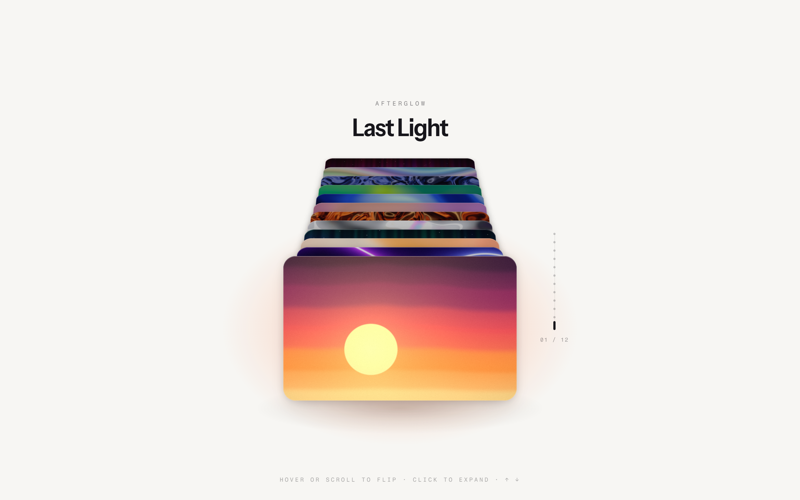

# Card Stack

An interactive 3D poster deck: twelve live WebGL posters stacked in perspective. Hover or scroll to flip through them, click a poster to expand it, and use the arrow keys, wheel or swipe on touch.

Built with Next.js (App Router), TypeScript, Tailwind CSS, Framer Motion and a single shared WebGL2 renderer.



## Run locally

```bash
pnpm install
pnpm dev
```

Then open http://localhost:3000.
