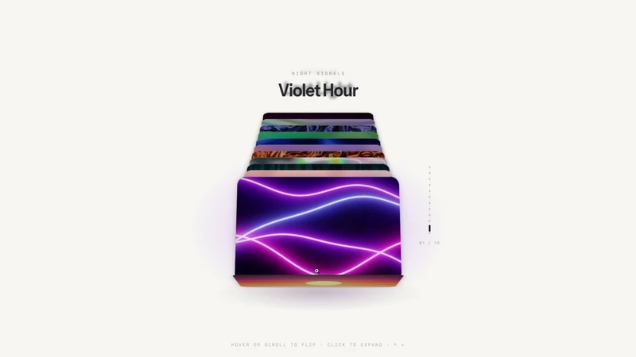

# Card Stack

[](docs/demo.mp4)

[Watch the full-quality demo (MP4, 22 s)](docs/demo.mp4)

An interactive 3D poster deck: twelve live WebGL posters stacked in perspective. Hover or scroll to flip through them, click a poster to expand it, and use the arrow keys, wheel or swipe on touch.

Built with Next.js (App Router), TypeScript, Tailwind CSS, Framer Motion and a single shared WebGL2 renderer.


## Run locally

```bash
pnpm install
pnpm dev
```

Then open http://localhost:3000.

## Deploying

Set `NEXT_PUBLIC_SITE_URL` to the site's public origin (for example `https://glow-deck.example.com`) so Open Graph and Twitter image URLs are absolute. On Vercel it falls back to the project's production URL, and to `http://localhost:3000` locally.
